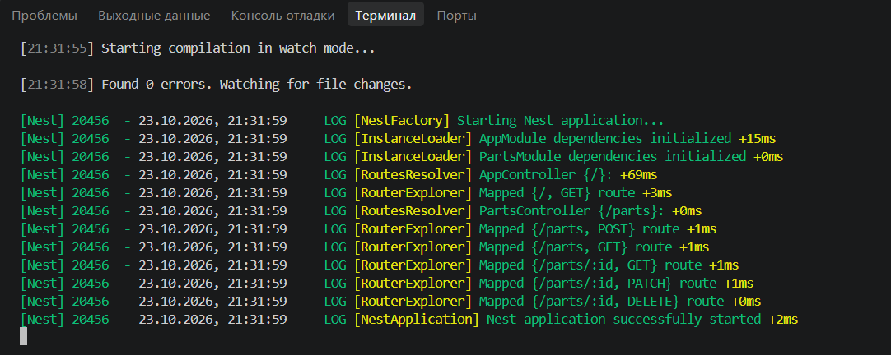
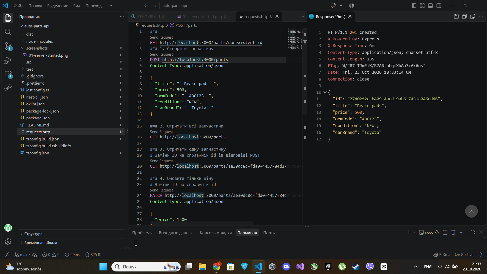
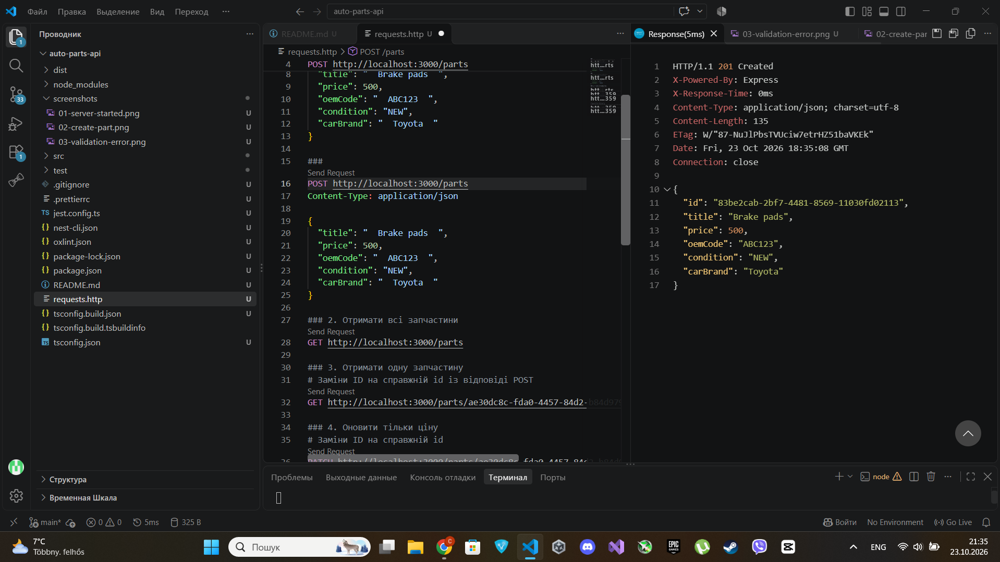
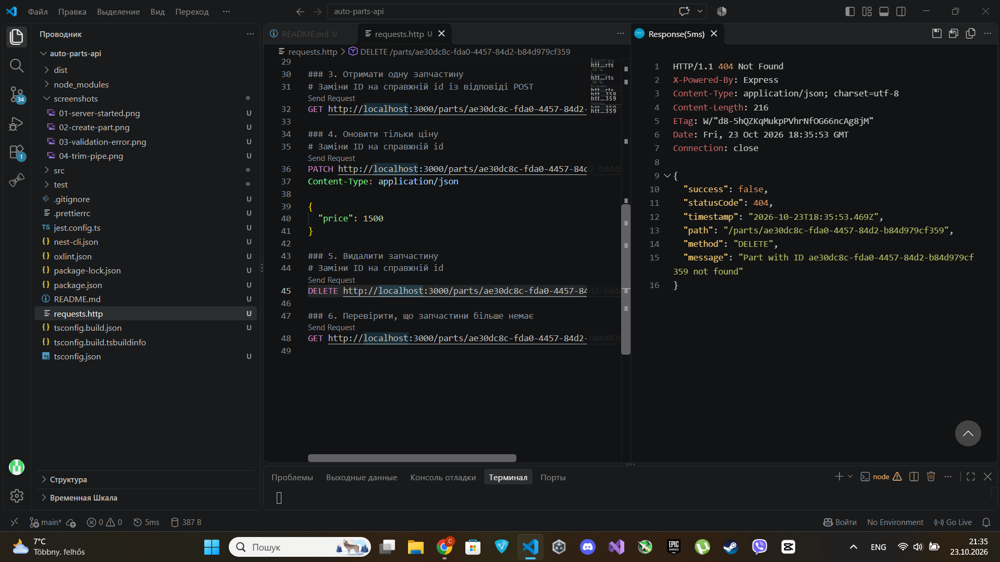
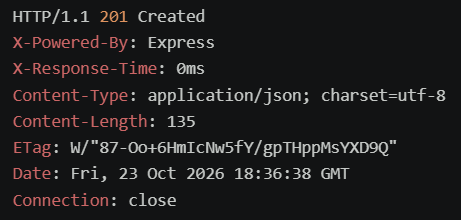
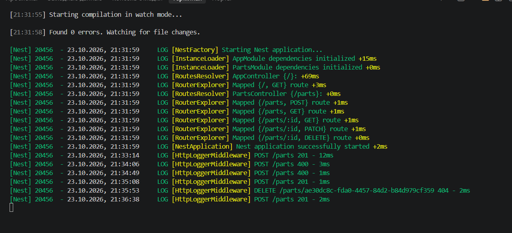

# Практична робота № 6
## Обробка HTTP-запитів у NestJS. API автозапчастин

### Тема роботи
Обробка HTTP-запитів у NestJS із використанням DTO, валідації, Pipe, Middleware, Exception Filter та Interceptor.

### Мета роботи
Навчитися створювати REST API на NestJS, перевіряти вхідні дані, обробляти помилки та реалізовувати додаткову обробку HTTP-запитів і відповідей.

### Варіант
№ 7 — API для автозапчастин.

## Використані технології
- Node.js
- TypeScript
- NestJS
- class-validator
- class-transformer
- REST Client для VS Code

## Функціональність API

API дозволяє створювати, переглядати, оновлювати та видаляти автозапчастини. Дані зберігаються в оперативній пам’яті.

Кожна автозапчастина містить такі поля:

| Поле | Тип | Опис |
|---|---|---|
| `id` | `string` | Унікальний ідентифікатор |
| `title` | `string` | Назва деталі |
| `price` | `number` | Додатна ціна |
| `oemCode` | `string` | OEM-код довжиною від 6 до 20 символів |
| `condition` | `Condition` | Стан: `NEW` або `REFURBISHED` |
| `carBrand` | `string` | Марка автомобіля |

### REST-ендпоїнти

| Метод | Шлях | Призначення |
|---|---|---|
| `POST` | `/parts` | Створити автозапчастину |
| `GET` | `/parts` | Отримати всі автозапчастини |
| `GET` | `/parts/:id` | Отримати деталь за ID |
| `PATCH` | `/parts/:id` | Оновити деталь |
| `DELETE` | `/parts/:id` | Видалити деталь |

## Реалізовані компоненти

### DTO та ValidationPipe
`CreatePartDto` і `UpdatePartDto` визначають структуру та правила перевірки вхідних даних. Валідація перевіряє типи полів, додатність ціни, довжину OEM-коду та допустимий стан деталі.

Глобальний `ValidationPipe` використовує параметри `whitelist`, `forbidNonWhitelisted` і `transform` для перевірки даних та відхилення зайвих полів.

### TrimPipe
Власний `TrimPipe` прибирає пробіли на початку й у кінці рядкових значень у тілі запиту. Наприклад, `"  Toyota  "` перетворюється на `"Toyota"`.

### HttpLoggerMiddleware
Middleware записує в консоль HTTP-метод, URL, статус відповіді та тривалість запиту.

Приклад:

`POST /parts 201 - 12ms`

### HttpExceptionFilter
Глобальний фільтр повертає помилки в узгодженому JSON-форматі з полями `success`, `statusCode`, `timestamp`, `path`, `method` і `message`.

Якщо деталь не знайдена, API повертає статус `404 Not Found`.

### ResponseTimeInterceptor
Interceptor вимірює час обробки успішної відповіді та додає HTTP-заголовок `X-Response-Time`, наприклад `X-Response-Time: 6ms`.

## Встановлення та запуск

### Вимоги
- Встановлений Node.js і npm.
- Visual Studio Code.
- Розширення REST Client для VS Code.

### Запуск проєкту
1. Відкрити термінал у папці проєкту.
2. Встановити залежності:

   ```bash
   npm install
   ```

3. Запустити сервер:

   ```bash
   npm run start:dev
   ```

4. Сервер за замовчуванням доступний за адресою `http://localhost:3000`.

## Тестування API

Запити виконувалися через REST Client у VS Code. У файлі `requests.http` кожен запит відокремлюється рядком `###`.

### Створення автозапчастини

```http
POST http://localhost:3000/parts
Content-Type: application/json

{
  "title": "Brake pads",
  "price": 500,
  "oemCode": "ABC123",
  "condition": "NEW",
  "carBrand": "Toyota"
}
```

Очікувана відповідь: `201 Created` і створена деталь з унікальним `id`.

### Отримання всіх деталей

```http
GET http://localhost:3000/parts
```

Очікувана відповідь: `200 OK` і масив автозапчастин.

### Перевірка валідації
Запит із від’ємною ціною або зайвим полем має повертати `400 Bad Request`.

### Перевірка TrimPipe
Після надсилання рядків із пробілами у відповіді вони мають бути обрізані.

### Перевірка Exception Filter

```http
GET http://localhost:3000/parts/nonexistent-id
```

Очікувана відповідь: `404 Not Found` з єдиним JSON-форматом помилки.

### Перевірка Interceptor і Middleware
- У заголовках відповіді перевіряється `X-Response-Time`.
- У терміналі перевіряється лог HTTP-запиту від `HttpLoggerMiddleware`.

## Скріншоти

Збережіть власні скріншоти в папці `screenshots` у корені проєкту.

1. `01-server-started.png` — успішний запуск сервера.
2. `02-create-part.png` — створення автозапчастини.
3. `03-validation-error.png` — помилка валідації.
4. `04-trim-pipe.png` — обрізання пробілів.
5. `05-exception-filter.png` — відповідь `404 Not Found`.
6. `06-response-time.png` — заголовок `X-Response-Time`.
7. `07-middleware-log.png` — лог middleware.

Додайте зображення до README після створення відповідних файлів:














## Висновок

Під час практичної роботи створено REST API для автозапчастин на NestJS із CRUD-операціями. Реалізовано DTO та валідацію вхідних даних, очищення рядків через Pipe, логування HTTP-запитів через Middleware, єдиний формат помилок через Exception Filter і вимірювання часу відповіді через Interceptor. Роботу компонентів перевірено тестовими HTTP-запитами.